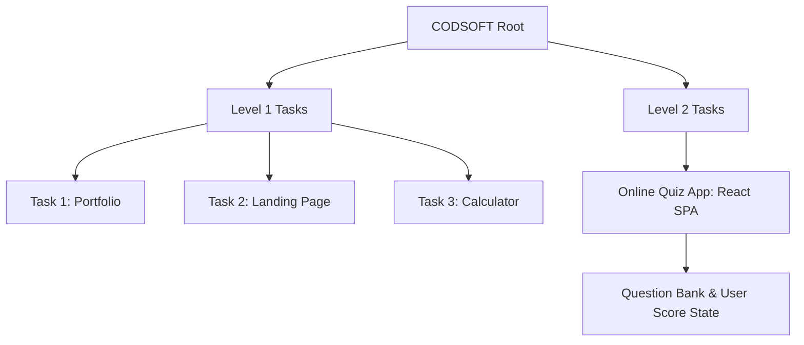

# Architecture Overview — CODSOFT Projects

## Structural Overview
The CODSOFT repository is partitioned by internship curriculum levels.

## Architectural Highlights
- **Level 1 (Vanilla Web)**: Employs modular CSS and event-driven JavaScript DOM manipulation. The calculator implements an arithmetic evaluation state machine.
- **Level 2 Task 3 (React Quiz App)**: Implements component state architecture (`useState`) to cycle through quiz questions, evaluate submitted answers, update current scores, and render summary feedback upon completion.
